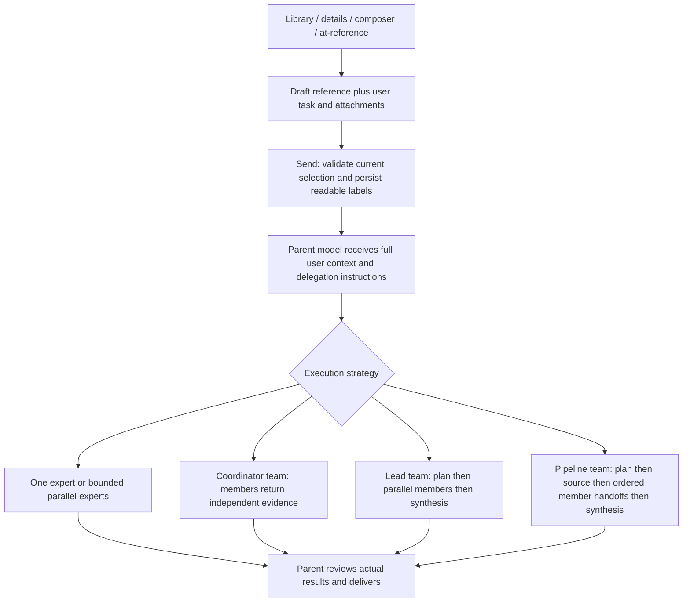

# ClawClaw Experts

ClawClaw Experts is a desktop-owned Cordis plugin. Its implementation, catalog,
settings, client UI, Remote API, and release lifecycle are part of
`dsh-plugin-desktop`. It reads bundled personas and validated local expert-plugin
packages; it has no separate network updater for the expert catalog.

## Product Surface

- 323 bilingual catalog experts across 22 divisions.
- Four bundled standalone expert packages and one three-member document team
  (330 expert identities in the combined catalog; team members are not standalone
  composer choices).
- Custom experts with editable persona, category, avatar, Skills, and MCP
  bindings.
- Thirteen built-in coordinator teams, the bundled document pipeline team, and
  custom or installed package teams.
- Expert and team selection from settings, the composer button, and `@`
  references.
- Model tools for listing and summoning individual experts or teams.
- Standard subagent execution and optional native Agent Team dispatch.

The Host face is exported as `dsh-plugin-desktop/experts`. The Remote face is
exported as `dsh-plugin-desktop/experts-remote`. The client face is mounted by
the desktop client entry so all three faces use the same ClawClaw release.

## Runtime Composition

### Team recall and selection

Recalling a team enables all of its member experts in one settings transaction.
The same transaction records its ID in `recalledTeams`. Only explicitly recalled
teams are selectable; enabling experts individually or recalling another team
with overlapping members never recalls a team implicitly. The record survives
restarts. Old settings without this field start with no recalled teams; previous
recall actions cannot be inferred reliably from enabled members.

The management page shows all teams. The composer menu and `@` candidates show
only recalled teams, using the shared `isTeamRecalled` predicate. Selecting from
the composer does not enable members. Disabling any member removes its teams
from the selection list until that member is enabled again (the explicit recall
record is retained). Deleting a custom team clears its record. Capability health is checked separately: disabled
members mean a team is not recalled; missing members or required capabilities
need repair; a pending capability check is not a repair failure.

Catalog and team receipts share the settings revision. A partial enabled-member
receipt must not mark an unloaded expert catalog as loaded, and an older query
must not overwrite a newer settings receipt. The live UI and cache regression
tests cover these boundaries.

Expert and team selections are admitted before delegation begins. The user message retains
readable expert, team and Skill labels for history replay; execution IDs are carried by a
separate instruction directing the normal `get_expert_team` and
`summon_expert_team` tools. Admission never waits for the team to finish.

Plugin teams default to parallel member work. A package may declare
`teamInfo.execution: "pipeline"` to run planning, source production by the lead,
members in `teamInfo.memberAgents` order, and final synthesis. Every member
receives the completed upstream handoffs. An upstream failure skips downstream
members. The bundled document team uses this mode for writing, formatting, and
conversion, with a fresh output directory for each invocation. Its personas use
these direct handoffs rather than another task's legacy pipeline state.

Planning cannot execute work tools. Expert activations also install a scoped
execution guard because preset-local delegation tools are outside the inherited
tool mask; these restrictions are restored when an expert session resumes.

### Client interaction and execution flow

| Surface | Action | Result |
| --- | --- | --- |
| Expert library | Enable/disable, edit a custom expert, or inspect a persona | Revision-checked settings update; no task is sent |
| Team library | Recall a team | Enables its members and records the team's recall ID atomically |
| Team library | Save/copy a team | Saves coordinator configuration; does not send a task |
| Composer or `@` menu | Select an expert or recalled team | Inserts a native reference and preserves the existing draft and attachments |
| Details sidebar | Select an example / Use in new chat | Prepares a conversation draft with the capability and example; the user confirms Send |
| Composer | Send | Revalidates current IDs and state, admits the user message, then delegates through normal tools |
| Running conversation | Stop | Propagates cancellation to active children; queued expert work does not start |
| History | Reopen a conversation | Renders durable capability labels without invoking them again |

Plugin-team child titles include the phase (planning, source production, member
execution or synthesis), so the existing subagent catalog can identify current work.

The composer disallows mixing individual experts with one team and limits each
submission to eight experts and sixteen Skills. Invalid or excess selections
are rejected rather than silently discarded. Required capability failures block
selection and execution; optional capability failures permit an explicit
degraded run. Capability checks still loading are distinct from ready states.

Native Agent Team dispatch is a separate engine for compatible coordinator
teams. Its dispatch response only acknowledges startup; the parent must wait
for member results. Teams requiring member-specific MCP isolation use standard
subagents. Restarting the Host interrupts live work; persisted identities,
configuration and existing files do not imply automatic workflow completion.

### October 2026 audit regression coverage

- Stable IDs resolve independently of localized names.
- Admission preserves attachments and does not wait for expert/team execution.
- Readable labels survive history replay; wire carriers do not render as code.
- Sequential document production supplies source before formatting and formatting
  evidence before conversion, with a fresh output directory per invocation.
- Planner restrictions also deny preset-local delegation after cold resume.
- Cancelled expert batches do not start queued members; empty expert answers fail.
- Plugin names participate in custom-team uniqueness checks in both languages.
- Package metadata fits the shared team snapshot bounds; missing optional quick
  prompts use the team's initial prompt as a valid example.
- Team details and sidebar participants distinguish coordinator, independent-lead,
  parallel and sequential strategies.

### Expert execution

An expert run is assembled from three parts at summon time:

1. The expert persona from the bundled catalog or custom settings.
2. Enabled Skill bindings resolved in the parent agent's active workspace.
3. Enabled MCP server bindings resolved from the live tool inventory.

Bindings have `enabled` and `required` flags. A missing required capability
stops the run. A missing optional capability is included in the expert's
diagnostics. Skill content is appended to the expert persona. When an expert
declares MCP bindings, MCP tools from every unselected server are denied.
Nested expert and team control tools are always denied inside an expert run.

The native Agent Team service currently accepts a persona but does not expose a
per-member tool filter. Skill-only teams can therefore use native dispatch. A
team containing an enabled MCP binding automatically uses standard subagents so
the selected-server boundary remains enforceable.

## Ownership And Updates

Built-in personas ship under `assets/experts/` and are included in desktop
packages. There is no expert-specific update check, download path, repository
button, or feedback link. Catalog and behavior changes are reviewed, tested,
and released with ClawClaw. Third-party attribution for derived persona content
remains in `assets/experts/LICENSE`, `assets/experts/NOTICE`, and
`THIRD_PARTY_NOTICES.md`.
